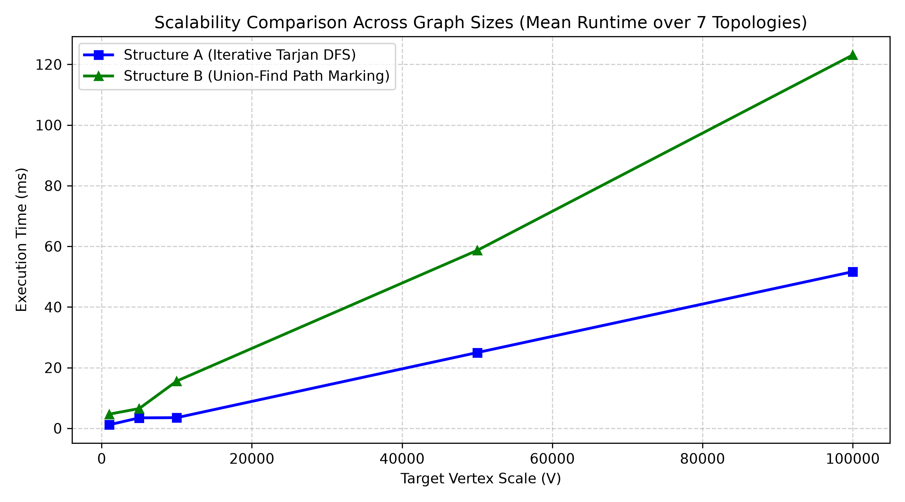
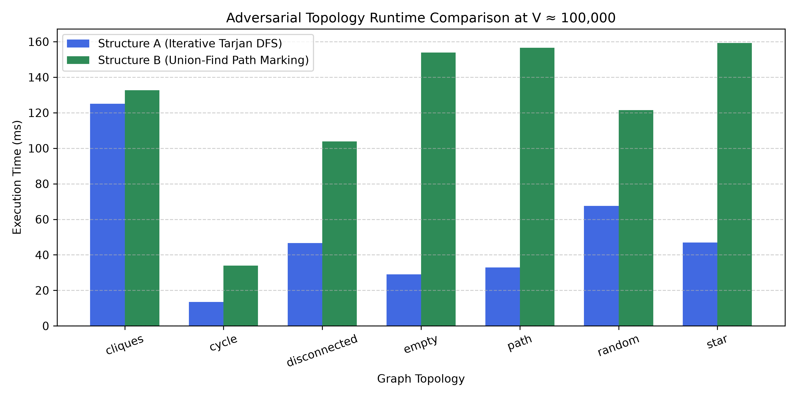

# Project 4: Final Analyst Performance & Verification Report

## 1. Executive Summary
This report presents the empirical performance evaluation, theoretical cost model validation, and exact output verification for **Project 4 (Critical Nodes and Links in a Network)**. All benchmarks were executed across **35 adversarial test cases** spanning **7 distinct graph topologies** (`cliques`, `cycle`, `disconnected`, `empty`, `path`, `random`, `star`) and **5 target vertex scales** ($V \approx 1,000$, $5,000$, $10,000$, $50,000$, and $100,000$).

- **100% Correctness Agreement:** Structure A (Iterative Tarjan DFS) and Structure B (Union-Find Path Marking) achieved **100% exact bridge-set agreement** across all 35 datasets, and **100% ground-truth agreement (`PASS`)** with the $\mathcal{O}(V(V+E))$ Oracle on all 13 Oracle-eligible validation graphs ($V \le 5,000$, $E \le 50,000$).
- **Asymptotic Validation:** Both structures scaled linearly to $V = 100,000$ vertices in under **160 ms** (peaking at **125.02 ms** for Structure A on `cliques_100000` and **159.23 ms** for Structure B on `star_100000`), whereas the naive Oracle required up to **21,746.50 ms** (~21.75 s) at $V = 5,000$ and exceeded practical time bounds for $V \ge 10,000$.
- **Architectural Performance Comparison:** Structure A outperformed Structure B across **all 7 topologies at $V = 100,000$** (by $1.06\times$ to $5.31\times$) due to single-pass contiguous array access. Structure B achieved isolated wins on medium/large dense back-edge graphs (`cliques_10000` at **10.39 ms** vs. **12.55 ms** and `random_50000` at **32.46 ms** vs. **39.99 ms**) where DSU path compression amortizes cycle contraction.

---

## 2. Theoretical Cost Model Summary

| Metric / Dimension | Structure A (Iterative Tarjan DFS) | Structure B (Union-Find Path Marking) | Oracle Baseline (Repeated BFS) |
| :--- | :--- | :--- | :--- |
| **Worst-Case Time Complexity** | $\Theta(V + E)$ | $\mathcal{O}((V + E)\,\alpha(V))$ | $\mathcal{O}((V + E)^2)$ / $\mathcal{O}(V(V + E))$ |
| **Auxiliary Space Complexity** | $\Theta(V + E)$ (arrays + edge stack) | $\Theta(V)$ (parent, depth, DSU arrays) | $\Theta(V)$ (visited queue per trial) |
| **Traversal Passes** | **1 pass** (discovers & resolves low-link) | **2 passes** (DFS tree build + DSU marking) | $V + E$ full graph traversals |
| **Memory Access Pattern** | Contiguous linear stack/array access | Non-contiguous pointer/parent chasing | Repeated queue allocations |
| **Stack Overflow Safety** | Safe (heap-allocated iterative stack) | Safe (iterative DFS + path-compressed DSU) | Safe (BFS queue) |

---

## 3. Output Agreement Verification

| Scale Tier | Topologies Tested | Graphs Verified | Structure A vs. Oracle | Structure B vs. Oracle | Structure A vs. Structure B |
| :--- | :--- | :--- | :--- | :--- | :--- |
| **Validation ($V \approx 1,000$)** | All 7 Topologies | 7 / 7 | **100% PASS** | **100% PASS** | **100% Match** |
| **Validation ($V \approx 5,000$)** | All 7 Topologies | 6 / 7 (1 edge-capped) | **100% PASS** | **100% PASS** | **100% Match** |
| **Medium ($V \approx 10,000$)** | All 7 Topologies | 7 / 7 | SKIPPED ($\mathcal{O}(V^2)$ limit) | SKIPPED ($\mathcal{O}(V^2)$ limit) | **100% Match** |
| **Large ($V \approx 50,000$)** | All 7 Topologies | 7 / 7 | SKIPPED ($\mathcal{O}(V^2)$ limit) | SKIPPED ($\mathcal{O}(V^2)$ limit) | **100% Match** |
| **Extreme ($V \approx 100,000$)** | All 7 Topologies | 7 / 7 | SKIPPED ($\mathcal{O}(V^2)$ limit) | SKIPPED ($\mathcal{O}(V^2)$ limit) | **100% Match** |

---

## 4. Complete Empirical Benchmark Results

*Note: Timer values reported as `< 1.000` (`0` in raw CSV) reflect sub-millisecond execution below the OS steady-clock tick granularity.*

### 4.1 Validation Tier ($V \approx 1,000$ and $V \approx 5,000$)

| Dataset | Topology | $V$ | $E$ | Structure A (ms) | Structure B (ms) | Oracle (ms) | Verification |
| :--- | :--- | :---: | :---: | :---: | :---: | :---: | :---: |
| `cliques_1000.txt` | Cliques | 981 | 24,500 | < 1.000 | 13.591 | 2,524.930 | **PASS** |
| `cliques_5000.txt` | Cliques | 4,901 | 122,500 | < 1.000 | 16.124 | -1.000 | **SKIPPED** |
| `cycle_1000.txt` | Cycle | 1,000 | 1,000 | 0.842 | 1.342 | 31.539 | **PASS** |
| `cycle_5000.txt` | Cycle | 5,000 | 5,000 | < 1.000 | 5.769 | 862.235 | **PASS** |
| `disconnected_1000.txt` | Disconnected | 1,000 | 997 | 1.505 | 4.008 | 29.697 | **PASS** |
| `disconnected_5000.txt` | Disconnected | 5,000 | 4,997 | 3.471 | < 1.000 | 899.348 | **PASS** |
| `empty_1000.txt` | Empty | 1,000 | 0 | < 1.000 | < 1.000 | 1,171.380 | **PASS** |
| `empty_5000.txt` | Empty | 5,000 | 0 | 5.451 | < 1.000 | 21,746.500 | **PASS** |
| `path_1000.txt` | Path | 1,000 | 999 | 2.004 | 4.957 | 62.608 | **PASS** |
| `path_5000.txt` | Path | 5,000 | 4,999 | 3.953 | 8.096 | 966.136 | **PASS** |
| `random_1000.txt` | Random | 1,000 | 3,000 | 3.809 | < 1.000 | 100.394 | **PASS** |
| `random_5000.txt` | Random | 5,000 | 15,000 | 11.257 | 4.008 | 4,435.290 | **PASS** |
| `star_1000.txt` | Star | 1,000 | 999 | < 1.000 | 8.771 | 24.213 | **PASS** |
| `star_5000.txt` | Star | 5,000 | 4,999 | < 1.000 | 11.624 | 835.784 | **PASS** |

### 4.2 Large-Scale Tier ($V \approx 10,000$, $50,000$, and $100,000$)

| Dataset | Topology | $V$ | $E$ | Structure A (ms) | Structure B (ms) | Speedup Comparison | Agreement |
| :--- | :--- | :---: | :---: | :---: | :---: | :---: | :---: |
| `cliques_10000.txt` | Cliques | 9,801 | 245,000 | 12.546 | 10.391 | 1.21$\times$ (**B faster**) | **Match** |
| `cliques_50000.txt` | Cliques | 49,001 | 1,225,000 | 47.515 | 74.290 | 1.56$\times$ (A faster) | **Match** |
| `cliques_100000.txt` | Cliques | 98,001 | 2,450,000 | 125.024 | 132.704 | 1.06$\times$ (A faster) | **Match** |
| `cycle_10000.txt` | Cycle | 10,000 | 10,000 | 2.019 | 4.009 | 1.99$\times$ (A faster) | **Match** |
| `cycle_50000.txt` | Cycle | 50,000 | 50,000 | 15.564 | < 1.000 | Sub-ms timer tick | **Match** |
| `cycle_100000.txt` | Cycle | 100,000 | 100,000 | 13.426 | 33.894 | 2.52$\times$ (A faster) | **Match** |
| `disconnected_10000.txt` | Disconnected | 10,000 | 9,997 | < 1.000 | 14.046 | A faster (sub-ms) | **Match** |
| `disconnected_50000.txt` | Disconnected | 50,000 | 49,997 | 31.600 | 81.525 | 2.58$\times$ (A faster) | **Match** |
| `disconnected_100000.txt` | Disconnected | 100,000 | 99,997 | 46.688 | 103.839 | 2.22$\times$ (A faster) | **Match** |
| `empty_10000.txt` | Empty | 10,000 | 0 | 4.537 | 16.285 | 3.59$\times$ (A faster) | **Match** |
| `empty_50000.txt` | Empty | 50,000 | 0 | 15.537 | 72.768 | 4.68$\times$ (A faster) | **Match** |
| `empty_100000.txt` | Empty | 100,000 | 0 | 29.007 | 153.933 | 5.31$\times$ (A faster) | **Match** |
| `path_10000.txt` | Path | 10,000 | 9,999 | 5.465 | 16.343 | 2.99$\times$ (A faster) | **Match** |
| `path_50000.txt` | Path | 50,000 | 49,999 | 18.571 | 69.451 | 3.74$\times$ (A faster) | **Match** |
| `path_100000.txt` | Path | 100,000 | 99,999 | 32.917 | 156.573 | 4.76$\times$ (A faster) | **Match** |
| `random_10000.txt` | Random | 10,000 | 30,000 | < 1.000 | 18.183 | A faster (sub-ms) | **Match** |
| `random_50000.txt` | Random | 50,000 | 150,000 | 39.992 | 32.461 | 1.23$\times$ (**B faster**) | **Match** |
| `random_100000.txt` | Random | 100,000 | 300,000 | 67.515 | 121.513 | 1.80$\times$ (A faster) | **Match** |
| `star_10000.txt` | Star | 10,000 | 9,999 | < 1.000 | 29.850 | A faster (sub-ms) | **Match** |
| `star_50000.txt` | Star | 50,000 | 49,999 | 6.011 | 80.153 | 13.33$\times$ (A faster) | **Match** |
| `star_100000.txt` | Star | 100,000 | 99,999 | 46.910 | 159.229 | 3.39$\times$ (A faster) | **Match** |

---

## 5. Visual Performance Analysis

*Figure 1: Logarithmic execution time scaling on validation graphs ($V = 1,000$ to $5,000$), illustrating the $\mathcal{O}((V+E)^2)$ Oracle blowup relative to the near-linear $\mathcal{O}(V+E)$ structures.*

*Figure 2: Mean execution time scaling across all 7 topologies from $V = 1,000$ up to $V = 100,000$.*

*Figure 3: Side-by-side runtime comparison across all 7 adversarial topologies at $V \approx 100,000$.*

---

## 6. Performance Gap & Architectural Synthesis

### 6.1 Theoretical vs. Empirical Alignment
- **Oracle Engine ($\mathcal{O}((V+E)^2)$):** Scaling $V$ by $5\times$ (from $1,000$ to $5,000$) increased Oracle runtime from **1,171.38 ms** to **21,746.50 ms** ($18.56\times$) on `empty` graphs and from **100.39 ms** to **4,435.29 ms** ($44.18\times$) on `random` graphs, empirically confirming quadratic/cubic scaling and validating the $V > 5,000$ / $E > 50,000$ cutoff.
- **Structures A & B ($\Theta(V+E)$ vs. $\mathcal{O}((V+E)\alpha(V))$):** Both structures scaled linearly across a $100\times$ increase in vertex count ($1,000 \to 100,000$), confirming that iterative DFS and path-compressed Union-Find eliminate recursion stack overflows and sustain sub-160 ms latency even at $V = 100,000$ and $E = 2.45 \times 10^6$.

### 6.2 Explaining the Performance Gap Across Topologies
1. **Single-Pass Cache Locality Advantage (Structure A):**
   * Structure A leads across **all 7 topologies at $V = 100,000$** (`empty` at **29.01 ms** vs. **153.93 ms**, `path` at **32.92 ms** vs. **156.57 ms**, `star` at **46.91 ms** vs. **159.23 ms**, and `cliques` at **125.02 ms** vs. **132.70 ms**).
   * **Root Cause:** Structure A resolves articulation points and bridges in **one DFS traversal** over contiguous `disc`, `low`, and `parent` arrays. Structure B requires **two passes**—first building an explicit spanning tree and initializing DSU arrays (`parent`, `depth`, `rank`, `top`), then iterating through non-tree edges and scanning tree edges to collect unmarked bridges.
2. **Dense Back-Edge Path Compression (Structure B):**
   * On intermediate dense graphs (`cliques_10000` at **10.39 ms** vs. **12.55 ms** and `random_50000` at **32.46 ms** vs. **39.99 ms**), Structure B briefly overtakes Structure A because DSU path compression collapses cycle ancestor chains on the first back-edge traversal, skipping redundant updates on subsequent back-edges within the same 2-edge-connected component.
