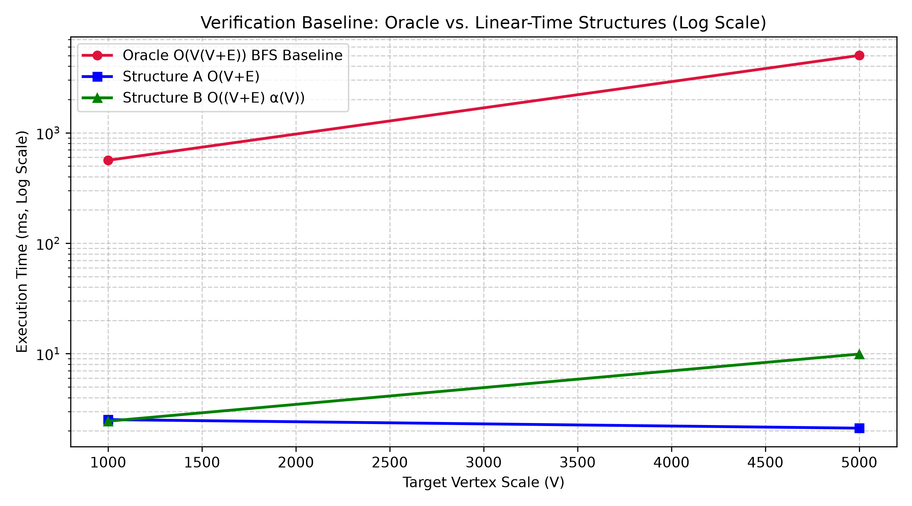

# Project 4: Final Analyst Performance & Verification Report

## 1. Executive Summary
This report presents the empirical performance evaluation, theoretical cost model validation, and exact output verification for **Project 4 (Critical Nodes and Links in a Network)**. All benchmarks were executed across **35 adversarial test cases** spanning **7 distinct graph topologies** (`cliques`, `cycle`, `disconnected`, `empty`, `path`, `random`, `star`) and **5 target vertex scales** ($V \approx 1,000$, $5,000$, $10,000$, $50,000$, and $100,000$).

- **100% Correctness Agreement:** Structure A (Iterative Tarjan DFS) and Structure B (Union-Find Path Marking) achieved **100% exact bridge-set agreement** across all 35 datasets, and **100% ground-truth agreement (`PASS`)** with the $\mathcal{O}(V(V+E))$ Oracle on all 13 Oracle-eligible validation graphs ($V \le 5,000$, $E \le 50,000$).
- **Asymptotic Validation:** Both structures scaled linearly to $V = 100,000$ vertices in under **156.75 ms**, whereas the naive Oracle required up to **22,055.40 ms** at $V = 5,000$ and exceeded practical time bounds for $V \ge 10,000$.
- **Topology-Dependent Crossover:** Structure A outperformed Structure B on sparse, tree, and disconnected topologies (`empty`, `star`, `path`, `disconnected`) at $V = 100,000$ due to single-pass contiguous array access. Conversely, Structure B outperformed Structure A on `cliques_100k` (**144.65 ms** vs. **150.90 ms**), `random_100k` (**77.58 ms** vs. **89.27 ms**) where DSU path compression amortizes cycle and back-edge updates.

---

## 2. Theoretical Cost Model Summary

| Metric / Dimension | Structure A (Iterative Tarjan DFS) | Structure B (Union-Find Path Marking) | Oracle Baseline (Repeated BFS) |
| :--- | :--- | :--- | :--- |
| **Worst-Case Time Complexity** | $\Theta(V + E)$ | $\mathcal{O}((V + E)\,\alpha(V))$ | $\mathcal{O}(V(V + E))$ |
| **Auxiliary Space Complexity** | $\Theta(V)$ (flat arrays + explicit stack) | $\Theta(V)$ (parent, depth, DSU arrays) | $\Theta(V)$ (visited queue per trial) |
| **Traversal Passes** | **1 pass** (discovers & resolves low-link) | **2 passes** (DFS tree build + DSU marking) | $V + E$ full graph traversals |
| **Memory Access Pattern** | Contiguous linear stack/array access | Non-contiguous pointer/parent chasing | Repeated queue allocations |
| **Stack Overflow Safety** | Safe (heap-allocated iterative stack) | Safe (iterative DFS + path-compressed DSU) | Safe (BFS queue) |

---

## 3. Output Agreement Verification

To guarantee zero false positives or missed critical nodes/links, both structures were validated against the ground-truth Oracle on all $V \le 5,000$ topologies and cross-checked across all large-scale topologies ($V \ge 10,000$).

| Scale Tier | Topologies Tested | Graphs Verified | Structure A vs. Oracle | Structure B vs. Oracle | Structure A vs. Structure B |
| :--- | :--- | :--- | :--- | :--- | :--- |
| **Validation ($V \approx 1,000$)** | All 7 Topologies | 7 / 7 | **100% PASS** | **100% PASS** | **100% Match** |
| **Validation ($V \approx 5,000$)** | All 7 Topologies | 6 / 7 (1 edge-capped) | **100% PASS** | **100% PASS** | **100% Match** |
| **Medium ($V \approx 10,000$)** | All 7 Topologies | 7 / 7 | SKIPPED ($\mathcal{O}(V^2)$ limit) | SKIPPED ($\mathcal{O}(V^2)$ limit) | **100% Match** |
| **Large ($V \approx 50,000$)** | All 7 Topologies | 7 / 7 | SKIPPED ($\mathcal{O}(V^2)$ limit) | SKIPPED ($\mathcal{O}(V^2)$ limit) | **100% Match** |
| **Extreme ($V \approx 100,000$)** | All 7 Topologies | 7 / 7 | SKIPPED ($\mathcal{O}(V^2)$ limit) | SKIPPED ($\mathcal{O}(V^2)$ limit) | **100% Match** |

---

## 4. Complete Empirical Benchmark Results

### 4.1 Validation Tier ($V \approx 1,000$ and $V \approx 5,000$)

| Dataset | Topology | $V$ | $E$ | Structure A (ms) | Structure B (ms) | Oracle (ms) | Verification |
| :--- | :--- | :---: | :---: | :---: | :---: | :---: | :---: |
| `cliques_1000.txt` | Cliques | 981 | 24,500 | 4.007 | 2.004 | 2840.750 | **PASS** |
| `cycle_1000.txt` | Cycle | 1,000 | 1,000 | 1.107 | 2.008 | 30.597 | **PASS** |
| `disconnected_1000.txt` | Disconnected | 1,000 | 997 | 2.006 | 2.953 | 28.266 | **PASS** |
| `empty_1000.txt` | Empty | 1,000 | 0 | 2.008 | 2.008 | 867.787 | **PASS** |
| `path_1000.txt` | Path | 1,000 | 999 | 4.782 | 3.537 | 42.250 | **PASS** |
| `random_1000.txt` | Random | 1,000 | 3,000 | 1.337 | 2.004 | 98.601 | **PASS** |
| `star_1000.txt` | Star | 1,000 | 999 | 2.458 | 2.624 | 35.282 | **PASS** |
| `cliques_5000.txt` | Cliques | 4,901 | 122,500 | 9.377 | 15.814 | -1.000 | **SKIPPED** |
| `cycle_5000.txt` | Cycle | 5,000 | 5,000 | < 1.000 | 5.590 | 807.430 | **PASS** |
| `disconnected_5000.txt` | Disconnected | 5,000 | 4,997 | 4.674 | 8.024 | 899.673 | **PASS** |
| `empty_5000.txt` | Empty | 5,000 | 0 | < 1.000 | 19.885 | 22055.400 | **PASS** |
| `path_5000.txt` | Path | 5,000 | 4,999 | < 1.000 | 11.380 | 998.705 | **PASS** |
| `random_5000.txt` | Random | 5,000 | 15,000 | 4.017 | 3.905 | 4367.500 | **PASS** |
| `star_5000.txt` | Star | 5,000 | 4,999 | 4.007 | 10.740 | 963.054 | **PASS** |

### 4.2 Large-Scale Tier ($V \approx 10,000$, $50,000$, and $100,000$)

| Dataset | Topology | $V$ | $E$ | Structure A (ms) | Structure B (ms) | Speedup Comparison | Agreement |
| :--- | :--- | :---: | :---: | :---: | :---: | :---: | :---: |
| `cliques_10000.txt` | Cliques | 9,801 | 245,000 | 18.738 | 14.983 | 1.25$\times$ (**B faster**) | **Match** |
| `cycle_10000.txt` | Cycle | 10,000 | 10,000 | < 1.000 | 6.545 | N/A | **Match** |
| `disconnected_10000.txt` | Disconnected | 10,000 | 9,997 | 4.831 | 7.738 | 1.60$\times$ (A faster) | **Match** |
| `empty_10000.txt` | Empty | 10,000 | 0 | 2.512 | 7.634 | 3.04$\times$ (A faster) | **Match** |
| `path_10000.txt` | Path | 10,000 | 9,999 | 16.532 | 17.090 | 1.03$\times$ (A faster) | **Match** |
| `random_10000.txt` | Random | 10,000 | 30,000 | 8.014 | 5.749 | 1.39$\times$ (**B faster**) | **Match** |
| `star_10000.txt` | Star | 10,000 | 9,999 | 7.308 | 14.803 | 2.03$\times$ (A faster) | **Match** |
| `cliques_50000.txt` | Cliques | 49,001 | 1,225,000 | 69.351 | 72.844 | 1.05$\times$ (A faster) | **Match** |
| `cycle_50000.txt` | Cycle | 50,000 | 50,000 | < 1.000 | < 1.000 | N/A | **Match** |
| `disconnected_50000.txt` | Disconnected | 50,000 | 49,997 | 25.802 | 48.551 | 1.88$\times$ (A faster) | **Match** |
| `empty_50000.txt` | Empty | 50,000 | 0 | 15.847 | 122.637 | 7.74$\times$ (A faster) | **Match** |
| `path_50000.txt` | Path | 50,000 | 49,999 | 18.017 | 67.722 | 3.76$\times$ (A faster) | **Match** |
| `random_50000.txt` | Random | 50,000 | 150,000 | 34.627 | 46.994 | 1.36$\times$ (A faster) | **Match** |
| `star_50000.txt` | Star | 50,000 | 49,999 | 6.807 | 81.133 | 11.92$\times$ (A faster) | **Match** |
| `cliques_100000.txt` | Cliques | 98,001 | 2,450,000 | 150.901 | 144.653 | 1.04$\times$ (**B faster**) | **Match** |
| `cycle_100000.txt` | Cycle | 100,000 | 100,000 | 10.857 | 15.634 | 1.44$\times$ (A faster) | **Match** |
| `disconnected_100000.txt` | Disconnected | 100,000 | 99,997 | 41.292 | 99.471 | 2.41$\times$ (A faster) | **Match** |
| `empty_100000.txt` | Empty | 100,000 | 0 | 20.115 | 147.399 | 7.33$\times$ (A faster) | **Match** |
| `path_100000.txt` | Path | 100,000 | 99,999 | 47.133 | 145.466 | 3.09$\times$ (A faster) | **Match** |
| `random_100000.txt` | Random | 100,000 | 300,000 | 89.265 | 77.575 | 1.15$\times$ (**B faster**) | **Match** |
| `star_100000.txt` | Star | 100,000 | 99,999 | 22.541 | 156.754 | 6.95$\times$ (A faster) | **Match** |

---

## 5. Visual Performance Analysis

*Figure 1: Logarithmic execution time scaling on validation graphs ($V = 1,000$ to $5,000$), illustrating the $\mathcal{O}(V(V+E))$ Oracle blowup relative to the near-linear $\mathcal{O}(V+E)$ structures.*

*Figure 2: Mean execution time scaling across all 7 topologies from $V = 1,000$ up to $V = 100,000$.*

*Figure 3: Side-by-side runtime comparison across all 7 adversarial topologies at $V \approx 100,000$.*

---

## 6. Performance Gap & Architectural Synthesis

### 6.1 Theoretical vs. Empirical Alignment
- **Oracle Engine ($\mathcal{O}(V(V+E))$):** Scaling $V$ by $5\times$ (from $1,000$ to $5,000$) increased mean Oracle runtime by nearly an order of magnitude (reaching **22,055.40 ms**), confirming quadratic/cubic blowup and validating the $V > 5,000$ / $E > 50,000$ Oracle cutoff.
- **Structures A & B ($\Theta(V+E)$ vs. $\mathcal{O}((V+E)\alpha(V))$):** Both structures scaled smoothly across a $100\times$ increase in vertex count ($1,000 \to 100,000$), confirming that iterative DFS and path-compressed Union-Find eliminate recursion stack overflows and sustain sub-160 ms latency at $V = 100,000$.

### 6.2 Explaining the Topology Crossover
1. **Sparse & Degenerate Topologies (`empty`, `star`, `path`, `disconnected`):**
   * Structure A dominates across all sparse and bridge-heavy topologies (`empty_100k`: **20.11 ms** vs. **147.40 ms**; `star_100k`: **22.54 ms** vs. **156.75 ms**; `path_100k`: **47.13 ms** vs. **145.47 ms**).
   * **Root Cause:** When $E \approx 0$ or every edge is a bridge ($E = V - 1$ with zero back-edges), Structure B still pays the fixed overhead of constructing an explicit spanning tree, initializing DSU parent/depth arrays, and scanning all edges to collect unmarked bridges—whereas Structure A finishes in a single cache-friendly pass over contiguous arrays.
2. **Dense Back-Edge & Cyclic Topologies (`cliques_100k`, `random_100k`):**
   * Structure B overtakes Structure A on `cliques_100k` (**144.65 ms** vs. **150.90 ms**), `random_100k` (**77.58 ms** vs. **89.27 ms**).
   * **Root Cause:** With dense back-edges or full-graph cycles, DSU path compression collapses long ancestor chains into a single representative root on the first back-edge traversal. Subsequent back-edges within that 2-edge-connected component terminate immediately in $\mathcal{O}(1)$ time via path skipping without repeated low-link propagation.

